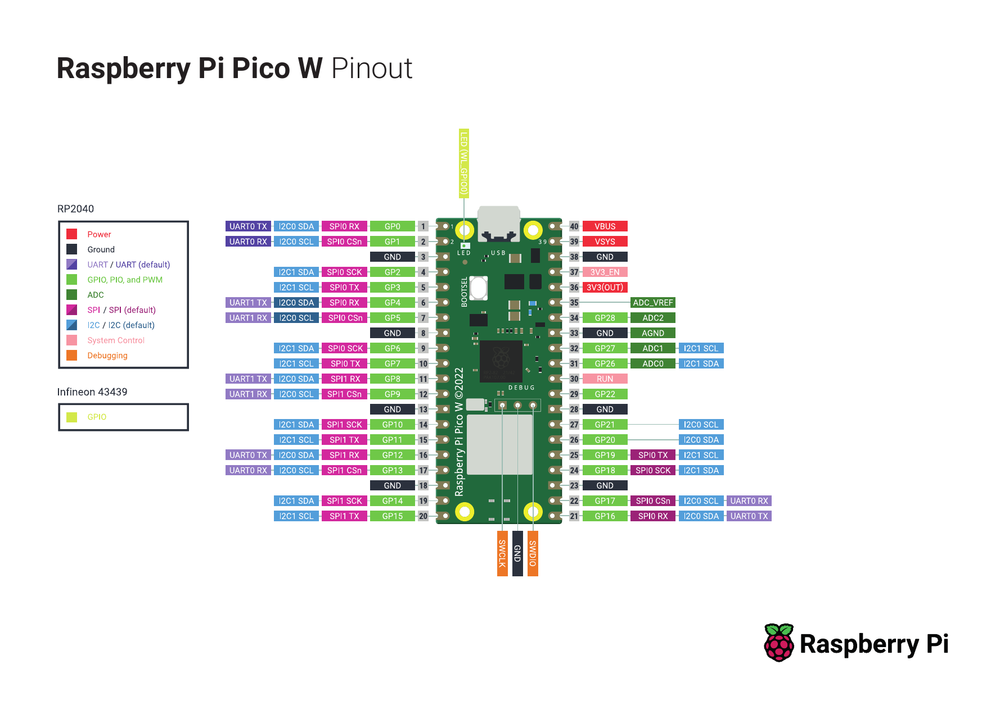

# Raspberry Pi Pico W – MicroPython Programming

<p align="center">
  
</p>

<h3 align="center">Raspberry Pi Pico W – Complete Practical Programming Guide</h3>

<p align="center">
  
</p>

## 1. Introduction

The Raspberry Pi Pico W is a low-cost microcontroller development board developed by Raspberry Pi. It is based on the RP2040 microcontroller and provides wireless connectivity through built-in Wi-Fi and Bluetooth Low Energy (BLE).

It is suitable for embedded systems, electronics interfacing, wireless communication, IoT applications and educational projects.

This repository provides a structured collection of practical experiments using Raspberry Pi Pico W and MicroPython, starting from basic programming and progressing towards advanced embedded and IoT applications.

## 2. Hardware Specifications

| Feature | Specification |
|---|---|
| Microcontroller | RP2040 |
| Processor | Dual-core ARM Cortex-M0+ |
| Clock Speed | Up to 133 MHz |
| SRAM | 264 KB |
| Flash Memory | 2 MB |
| GPIO | 26 multifunction GPIO |
| ADC | 3 external 12-bit ADC inputs |
| PWM | 16 channels |
| UART | 2 |
| SPI | 2 |
| I2C | 2 |
| Wireless LAN | 2.4 GHz IEEE 802.11 b/g/n |
| Bluetooth | Bluetooth 5.2 / BLE support |
| Programming | MicroPython, C/C++ |
| USB | Micro USB |

## 3. What is MicroPython?

MicroPython is a lightweight implementation of Python 3 designed to run on microcontrollers and embedded systems.

It allows developers to control hardware peripherals such as GPIO, ADC, PWM, UART, SPI and I2C using simple Python syntax.

### Why MicroPython?

- Simple and easy-to-understand syntax.
- Direct hardware access.
- Faster development and prototyping.
- Built-in support for Wi-Fi and BLE on Pico W.
- Suitable for embedded and IoT applications.

## 4. Required Hardware and Software

### Hardware

- Raspberry Pi Pico W
- Micro USB data cable
- Breadboard
- Jumper wires
- LEDs and resistors
- Push buttons
- Sensors and display modules

### Software

- Ubuntu / Windows / macOS
- Visual Studio Code
- MicroPico VS Code Extension
- MicroPython firmware
- Python 3
- Git and GitHub

## 5. Installing MicroPython Firmware

MicroPython firmware must be installed on the Raspberry Pi Pico W before programming it.

### Step 1: Download firmware

Visit the official Raspberry Pi MicroPython documentation:

https://www.raspberrypi.com/documentation/microcontrollers/micropython.html

Download the latest firmware specifically for **Raspberry Pi Pico W**.

Make sure you select Pico W, not the standard Pico or Pico 2 W firmware.

### Step 2: Enter BOOTSEL mode

1. Disconnect the Pico W from USB.
2. Press and hold the BOOTSEL button.
3. Connect the USB cable to your computer while holding BOOTSEL.
4. Release the button when the board appears as a USB storage device.

The device should appear as:

`RPI-RP2`

### Step 3: Install firmware

1. Open the RPI-RP2 drive.
2. Drag and drop the downloaded `.uf2` firmware file.
3. Wait for the board to restart automatically.

MicroPython is now installed.

**Note:** Firmware installation is normally required only once. You do not need to repeat it every time you upload a program.

## 6. Installing Visual Studio Code

Download Visual Studio Code:

https://code.visualstudio.com/

For Ubuntu, VS Code can also be installed using the official package instructions.

Check the installation:

```bash
code --version
```

## 7. Installing MicroPico Extension

MicroPico provides a development environment for programming Raspberry Pi Pico and Pico W using MicroPython.

### Step 1: Open VS Code

Launch Visual Studio Code.

### Step 2: Open Extensions

Press:

`Ctrl + Shift + X`

Search for:

`MicroPico`

Install the MicroPico extension published by Paul Oberosler.

Marketplace:

https://marketplace.visualstudio.com/items?itemName=paulober.pico-w-go

### Step 3: Install supporting extensions

Install these VS Code extensions if they are not already installed:

- Python
- Pylance
- IntelliCode

### Step 4: Initialize MicroPico project

1. Open your project folder in VS Code.
2. Press `Ctrl + Shift + P`.
3. Search for `MicroPico: Initialize MicroPico Project`.
4. Select the command and complete the initialization.

MicroPico configures the project for MicroPython development.

## 8. Connecting Pico W to VS Code

1. Connect Pico W using a USB data cable.
2. Make sure MicroPython firmware is installed.
3. Open the MicroPico extension in VS Code.
4. Connect to the detected Raspberry Pi Pico W.
5. Open the MicroPico REPL to interact with the board.

On Ubuntu, if you encounter serial permission errors, execute:

```bash
sudo usermod -aG dialout $USER
```

Log out and log in again for the group change to take effect.

Check the connected serial device:

```bash
ls /dev/ttyACM*
```

## 9. First MicroPython Program – Hello World

Create a file named:

`main.py`

Program:

```python
print("Hello World!")
print("Welcome to Raspberry Pi Pico W")
print("MicroPython is running successfully")
```

### Uploading the program

1. Save `main.py`.
2. Connect the Pico W.
3. Open the VS Code Command Palette.
4. Select `MicroPico: Run Current File on Board`.
5. Observe the output in the MicroPico REPL.

Expected output:

```text
Hello World!
Welcome to Raspberry Pi Pico W
MicroPython is running successfully
```

## 10. First Hardware Program – Onboard LED Blink

The Pico W contains an onboard LED controlled through the wireless chip.

Program:

```python
from machine import Pin
import time

led = Pin("LED", Pin.OUT)

while True:
    led.on()
    time.sleep(1)

    led.off()
    time.sleep(1)
```

Upload and execute the program.

The onboard LED should turn ON and OFF at one-second intervals.

## 11. Uploading Programs to Pico W

MicroPico provides commands for transferring programs between VS Code and the board.

Common operations include:

- Run Current File on Board
- Upload Project to Board
- Download Project from Board
- Restart Board
- Stop Execution
- Open REPL

A file named `main.py` stored on the Pico W automatically executes when the board starts.

## 12. Repository Structure

This repository is organized into different experiment categories.

```text
Raspberry-Pi-Pico-W-MicroPython/
│
├── README.md
├── assets/
│
├── 01_Getting_Started/
│
├── 02_GPIO/
│
├── 03_PWM/
│
├── 04_ADC/
│
├── 05_Communication_Protocols/
│
├── 06_Display_Interfacing/
│
├── 07_Sensor_Interfacing/
│
├── 08_WiFi/
│
├── 09_Bluetooth_LE/
│
├── 10_IoT_Applications/
│
├── 11_RTOS_and_Concurrency/
│
├── 12_External_Memory/
│
└── 13_Advanced_Projects/
```

Each experiment contains:

- `main.py` – MicroPython source code.
- `README.md` – Experiment description, wiring, explanation and expected output.

## 13. Important Hardware Precautions

- Pico W GPIO operates at 3.3V.
- GPIO pins are not 5V tolerant.
- Use suitable current-limiting resistors with LEDs.
- Check sensor operating voltage before interfacing.
- Use a common ground when connecting external modules.
- Use suitable level shifters when interfacing with 5V logic devices.

## 14. Learning Outcomes

By completing the experiments in this repository, learners will understand:

- MicroPython programming fundamentals.
- GPIO programming and peripheral control.
- PWM and ADC interfacing.
- UART, SPI and I2C communication.
- Sensor and display interfacing.
- Wi-Fi and BLE communication.
- IoT protocols and cloud connectivity.
- Embedded system application development.


## License

This project is licensed under the MIT License.

You are free to use, modify, and distribute this project
subject to the terms and conditions of the MIT License.

See the [LICENSE](LICENSE) file for details.

## 15. References

- Raspberry Pi Pico W Documentation:
  https://www.raspberrypi.com/documentation/microcontrollers/

- MicroPython Documentation:
  https://docs.micropython.org/

- MicroPython Firmware:
  https://micropython.org/download/RPI_PICO_W/

- MicroPico Extension:
  https://github.com/paulober/MicroPico

- Raspberry Pi Pico W Datasheet:
  https://datasheets.raspberrypi.com/picow/pico-w-datasheet.pdf

---

<p align="center">
  <b>Developed and maintained by IPCS Global – Embedded Systems Team</b>
</p>

<p align="center">
  Raspberry Pi Pico W | MicroPython | Embedded Systems | IoT
</p>
